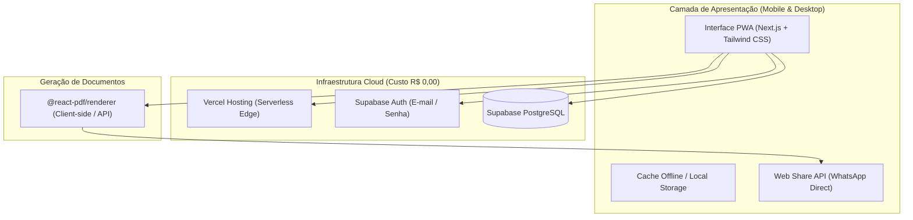
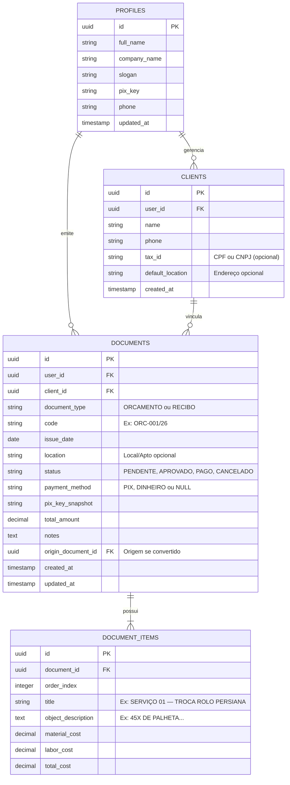
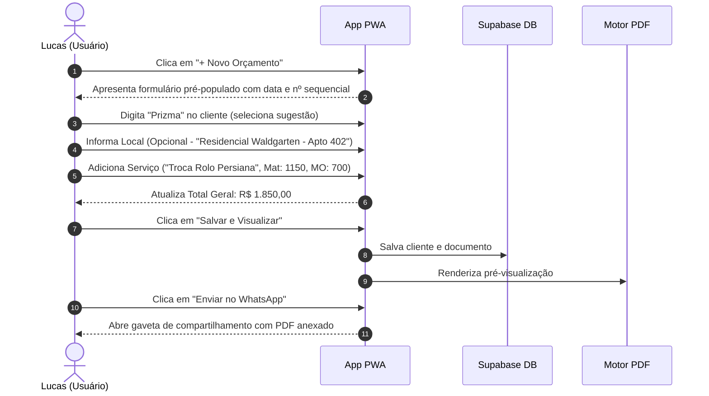
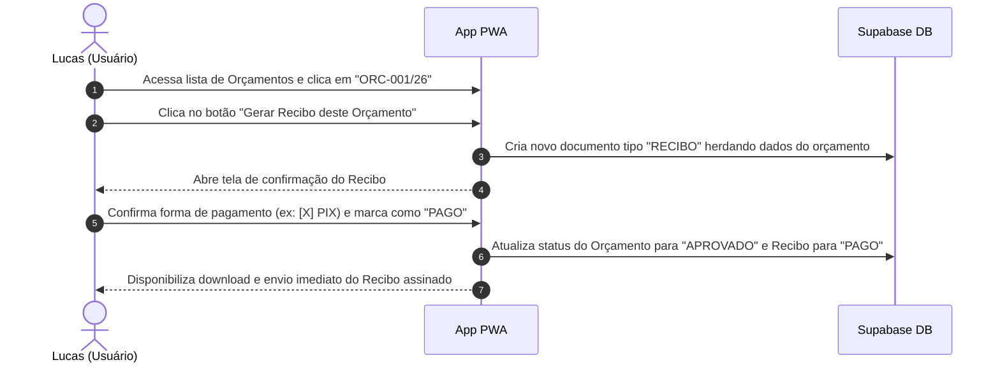

# Especificação de Requisitos e Arquitetura de Software (SRS)
## Sistema de Orçamentos, Recibos e Gestão Financeira — AVI Alumínios e Vidros

---

## 1. Visão Geral do Produto

### 1.1 Contexto e Justificativa
O cliente atua formalmente no setor de esquadrias e vidros na empresa Líder, mas executa manutenções, regulagens e pequenas instalações de forma autônoma sob a marca **AVI Alumínios e Vidros**. Seu público engloba administradoras de imóveis (ex: Imobiliária Prizma), condomínios residenciais e clientes particulares.

Atualmente, a geração de orçamentos e recibos é feita via prompts no ChatGPT. Esse processo acarreta:
- **Alto retrabalho operacional:** qualquer correção ortográfica ou de valor demanda reexecutar o prompt inteiro.
- **Insegurança e despadronização:** oscilações na formatação dos PDFs gerados pela IA.
- **Inexistência de histórico e controle financeiro:** perda da rastreabilidade de serviços executados, valores a receber e receita mensal.

### 1.2 Objetivo do Sistema
Desenvolver uma **Aplicação Web Progressiva (PWA)** mobile-first para emissão ágil de **Orçamentos** e **Recibos de Prestação de Serviços**, com conversão em 1-clique, histórico editável, compartilhamento direto via WhatsApp e painel de controle financeiro com exportação de relatórios.

---

## 2. Arquitetura Técnica & Stack Tecnológica

### 2.1 Justificativa das Tecnologias
- **Next.js (App Router) + TypeScript + Tailwind CSS:** Plataforma única para frontend e API routes. Interface responsiva com foco na usabilidade em telas de smartphones.
- **PWA (Progressive Web App):** Instalável no celular sem os custos e prazos de aprovação das lojas (Apple App Store / Google Play). Funciona em tela cheia e com ícone na gaveta de aplicativos.
- **Supabase (PostgreSQL Gerenciado):** Modelo relacional compatível com a experiência prévia em MySQL, com interface gráfica web intuitiva e autenticação pronta com RLS (*Row Level Security*).
- **`@react-pdf/renderer`:** Compilação dos layouts visuais de Orçamento e Recibo diretamente no navegador do cliente, garantindo fidelidade gráfica e download instantâneo.
- **SheetJS (xlsx):** Exportação client-side do relatório financeiro consolidado em formato Excel/CSV.

---

## 3. Regras de Negócio (RN)

- **RN-01 — Identidade Visual Pré-Configurada:** Todos os documentos gerados devem portar o cabeçalho oficial da *AVI Alumínios e Vidros*, logotipo padrão, slogan (*"Manutenções em vidros e alumínios • Instalações de esquadrias em geral • Telhados"*), versículo (*"Seja forte e corajoso — Josué 1:9"*) e chave PIX padrão (`47 99659-4199`).
- **RN-02 — Numeração Sequencial dos Documentos:**
  - Cada documento recebe um identificador sequencial amigável por ano (ex: `ORC-001/26` para orçamentos e `REC-001/26` para recibos).
  - A numeração é exibida com destaque no topo do documento para servir de protocolo perante imobiliárias e condomínios.
- **RN-03 — Segregação entre Contratante e Local de Execução:**
  - O sistema deve distinguir o **Cliente Faturado** (ex: Imobiliária Prizma, CNPJ opcional, telefone) do **Local do Serviço / Endereço (Opcional)** (ex: *Residencial Waldgarten - Apto 402, Bloco 02*). Caso não seja preenchido, o documento omite o campo sem quebrar o layout.
- **RN-04 — Conversão 1-Clique (Orçamento para Recibo):**
  - Orçamentos com status `Aprovado` podem ser convertidos automaticamente em Recibos com um único clique.
  - O sistema herda cliente, local (se houver), itens executados e valor total, gerando um novo registro de recibo sem necessidade de redigitação.
- **RN-05 — Formas de Pagamento e Dados Bancários:**
  - Métodos aceitos limitados a **PIX** e **Dinheiro**.
  - Quando a forma de pagamento selecionada for PIX, a chave cadastrada deve constar explicitamente no corpo do recibo.
- **RN-06 — Estrutura de Itens do Serviço:**
  - No Orçamento, cada item de serviço permite a discriminação entre **Valor de Material** e **Valor de Mão de Obra**, calculando o subtotal daquele item e o total geral da proposta.
  - No Recibo, caso o serviço seja simplificado (ex: regulagem de fecho), permite preenchimento direto da descrição e valor consolidado.
- **RN-07 — Assinaturas Físicas:**
  - Os recibos em PDF devem apresentar as linhas pontilhadas de assinatura para *AVI Alumínios e Vidros* e *Cliente / Responsável*.
- **RN-08 — Controle Financeiro de Faturamento Bruto:**
  - O dashboard financeiro contabilizará o somatório de documentos com status `PAGO` dentro do mês de competência, exibindo indicadores de serviços realizados e ticket médio.

---

## 4. Requisitos Funcionais (RF)

### Módulo 1: Autenticação & Configurações
- **RF-01:** Autenticação de usuário único via e-mail e senha.
- **RF-02:** Gerenciamento dos dados da empresa emitente (Nome Fantasia, Chave PIX padrão, Telefone de Contato, Slogan).

### Módulo 2: Gestão de Clientes & Locais
- **RF-03:** Cadastro ágil de clientes (Nome/Razão Social obrigatório, Telefone/WhatsApp opcional, CPF/CNPJ opcional, Endereço padrão opcional).
- **RF-04:** Autocompletar inteligente na emissão: ao digitar o nome de um cliente existente, os dados vinculados são carregados instantaneamente.
- **RF-05:** Histórico individual de todos os orçamentos e recibos atrelados a cada cliente.

### Módulo 3: Emissão e Gestão de Orçamentos
- **RF-06:** Formulário de criação de Orçamento contendo:
  - Número do documento (gerado automaticamente, editável se necessário).
  - Data de emissão (padrão: data atual).
  - Seleção/cadastro de cliente e campo de texto livre **opcional** para Local/Apartamento/Bloco.
  - Tabela dinâmica de serviços (adicionar/remover itens com título, especificação do objeto, valor de material e valor de mão de obra).
  - Campo de observações (pré-preenchido com texto padrão referente a validade/materiais, totalmente editável).
- **RF-07:** Edição e exclusão de orçamentos previamente emitidos.
- **RF-08:** Gestão de status do orçamento: `Pendente`, `Aprovado`, `Recusado`.

### Módulo 4: Emissão e Gestão de Recibos
- **RF-09:** Emissão de Recibo avulso ou a partir de um Orçamento pré-existente.
- **RF-10:** Seleção de forma de pagamento (`PIX` ou `Dinheiro`).
- **RF-11:** Campo de texto declaratório padrão: *"Declaro, para os devidos fins, que o valor acima corresponde ao serviço descrito neste recibo."*
- **RF-12:** Gestão de status do recibo: `Aguardando Pagamento`, `Pago`.

### Módulo 5: Pré-visualização, PDF e Envio
- **RF-13:** Pré-visualização instantânea do PDF na tela antes da emissão final.
- **RF-14:** Download do arquivo PDF no dispositivo com nomenclatura padronizada (ex: `Recibo_Prizma_Apto301_06112026.pdf`).
- **RF-15:** Botão "Enviar no WhatsApp":
  - Em dispositivos móveis: aciona a Web Share API anexando diretamente o arquivo PDF.
  - Em navegadores desktop: aciona a URL `https://wa.me/{numero}` com mensagem padrão e link/orientação de download.

### Módulo 6: Dashboard Financeiro & Relatórios
- **RF-16:** Cards de métricas no topo da tela inicial:
  - Faturamento do Mês Atual (R$).
  - Quantidade de serviços finalizados no mês.
  - Valores pendentes (Orçamentos aprovados aguardando pagamento).
- **RF-17:** Filtro por período (Mês atual, Mês anterior, Ano corrente ou Intervalo customizado).
- **RF-18:** Exportação de relatório em planilha Excel (.xlsx / .csv) listando: Data, Número, Cliente, Local, Descrição resumida, Forma de Pagamento e Valor Total.

---

## 5. Requisitos Não-Funcionais (RNF)

- **RNF-01 — Responsividade Mobile-First:** 100% das telas devem ser otimizadas para manuseio em smartphones com apenas uma mão (botões confortáveis para toque, teclado numérico automático para campos de moeda).
- **RNF-02 — Instalação PWA:** Disponibilizar arquivo `manifest.json` e Service Worker para permitir instalação na tela inicial no iOS (Safari) e Android (Chrome).
- **RNF-03 — Performance de Geração:** A renderização do documento PDF e o disparo para WhatsApp devem ocorrer em menos de 2 segundos.
- **RNF-04 — Custo Operacional Zero:** Arquitetura 100% elegível para as cotas gratuitas perpétuas da Vercel e Supabase.
- **RNF-05 — Segurança de Acesso:** Proteção das tabelas do banco de dados via Supabase RLS (*Row Level Security*), garantindo que somente o usuário autenticado tenha acesso aos registros.

---

## 6. Modelo de Dados Relacional (PostgreSQL / Supabase)

### 6.1 Dicionário de Dados

#### Tabela: `clients`
| Campo | Tipo | Nulo? | Descrição |
| :--- | :--- | :--- | :--- |
| `id` | `UUID` | Não | Chave primária (`gen_random_uuid()`) |
| `user_id` | `UUID` | Não | FK para `auth.users` |
| `name` | `VARCHAR(255)` | Não | Nome ou Razão Social |
| `phone` | `VARCHAR(20)` | Sim | WhatsApp do cliente |
| `tax_id` | `VARCHAR(20)` | Sim | CPF ou CNPJ (opcional) |
| `default_location` | `VARCHAR(255)` | Sim | Endereço ou condomínio padrão (opcional) |
| `created_at` | `TIMESTAMPTZ` | Não | Data de cadastro |

#### Tabela: `documents`
| Campo | Tipo | Nulo? | Descrição |
| :--- | :--- | :--- | :--- |
| `id` | `UUID` | Não | Chave primária (`gen_random_uuid()`) |
| `user_id` | `UUID` | Não | FK para `auth.users` |
| `client_id` | `UUID` | Não | FK para `clients.id` |
| `document_type` | `VARCHAR(20)` | Não | `'ORCAMENTO'` ou `'RECIBO'` |
| `code` | `VARCHAR(30)` | Não | Identificador público (ex: `REC-014/26`) |
| `issue_date` | `DATE` | Não | Data indicada no documento |
| `location` | `TEXT` | Sim | Local do imóvel / serviço (opcional) |
| `status` | `VARCHAR(20)` | Não | `'PENDENTE'`, `'APROVADO'`, `'PAGO'`, `'CANCELADO'` |
| `payment_method` | `VARCHAR(20)` | Sim | `'PIX'`, `'DINHEIRO'` ou `NULL` |
| `pix_key_snapshot` | `VARCHAR(100)` | Sim | Cópia da chave PIX vigente no momento da emissão |
| `total_amount` | `NUMERIC(10,2)`| Não | Somatório total do documento |
| `notes` | `TEXT` | Sim | Observações adicionais ou termos |
| `origin_document_id` | `UUID` | Sim | Auto-relacionamento (caso o recibo tenha vindo de um orçamento) |
| `created_at` | `TIMESTAMPTZ` | Não | Timestamp de criação |

#### Tabela: `document_items`
| Campo | Tipo | Nulo? | Descrição |
| :--- | :--- | :--- | :--- |
| `id` | `UUID` | Não | Chave primária (`gen_random_uuid()`) |
| `document_id` | `UUID` | Não | FK para `documents.id` (ON DELETE CASCADE) |
| `order_index` | `INTEGER` | Não | Ordem de exibição no documento |
| `title` | `VARCHAR(255)` | Não | Título do serviço |
| `object_description`| `TEXT` | Sim | Especificação de materiais / medidas |
| `material_cost` | `NUMERIC(10,2)`| Sim | Subtotal de materiais |
| `labor_cost` | `NUMERIC(10,2)`| Sim | Subtotal de mão de obra |
| `total_cost` | `NUMERIC(10,2)`| Não | Subtotal geral da linha |

---

## 7. Fluxos do Usuário (Wireflows)

### Fluxo 1: Emissão Rápida de Orçamento no Celular

### Fluxo 2: Conversão de Orçamento em Recibo (Pós-Aprovação)

---

## 8. Especificação Visual dos Documentos PDF

### 8.1 Padrão Visual Global
- **Tipografia:** Helvetica / Arial (alta legibilidade e compatibilidade nativa em PDF).
- **Paleta de Cores:**
  - Primária (Verde Floresta Escuro): `#14452F` (utilizada nas barras de título de serviços e cabeçalhos de destaque).
  - Secundária (Laranja Telha): `#D9531E` (utilizada na logomarca e divisórias decorativas).
  - Fundo de Tabelas: `#F8F9FA` com linhas em `#E5E7EB`.
  - Texto Principal: `#1F2937` (cinza grafite escuro).

### 8.2 Layout: Orçamento (Proposta Comercial)
1. **Cabeçalho:** Logo oficial à esquerda; à direita, título **"ORÇAMENTO"**, subtítulo *"Proposta comercial de serviços"*, data de emissão e número do orçamento.
2. **Dados Principais:** Faixa limpa com rótulos destacados: **Cliente** e **Local** (omitido se vazio).
3. **Blocos de Serviços Dinâmicos:**
   - Barra verde com: `SERVIÇO 01 — [NOME DO SERVIÇO]`
   - Bloco descritivo com especificação do Objeto/Peças.
   - Tabela compacta com colunas **Descrição** e **Valor** discriminando: *Material*, *Mão de obra* e *Total do serviço*.
4. **Fechamento Financeiro:** Destaque em moldura para o **TOTAL GERAL DO ORÇAMENTO**.
5. **Observações:** Texto padrão explicativo sobre composição de custos.
6. **Rodapé Institucional:** Centralizado, com nome da empresa e versículo bíblico de rodapé.

### 8.3 Layout: Recibo de Prestação de Serviços
1. **Cabeçalho:** Logotipo oficial centralizado sobreposto por barra horizontal laranja; Título em caixa alta: **RECIBO DE PRESTAÇÃO DE SERVIÇOS**.
2. **Data & Identificação:** Data de quitação e identificação clara do Nome / Razão Social do Contratante.
3. **Descrição da Execução:** Bloco único destacando o serviço realizado e o endereço do imóvel/condomínio atendido (se informado).
4. **Valor e Pagamento:**
   - Caixa em destaque com o **VALOR DO SERVIÇO (R$)**.
   - Caixa de seleção gráfica: `[X] PIX   [ ] Dinheiro` acompanhada da **Chave PIX: 47 99659-4199**.
5. **Termo Legal:** Cláusula padrão de quitação e correspondência do valor.
6. **Campos de Assinatura:** Duas linhas simétricas lado a lado:
   - `AVI ALUMÍNIOS E VIDROS`
   - `CLIENTE / RESPONSÁVEL`

---

## 9. Plano de Execução do Projeto

| Fase | Entregáveis | Critério de Aceite |
| :--- | :--- | :--- |
| **Fase 1: Setup & Banco** | Projeto Next.js com Tailwind, PWA configurado, tabelas e políticas de segurança no Supabase. | Login funcional e conexão com o banco de dados validada. |
| **Fase 2: Motor de PDF** | Templates visuais em `@react-pdf/renderer` para Orçamento e Recibo com identidade da AVI. | PDFs gerados idênticos visualmente aos arquivos modelo originais. |
| **Fase 3: CRUD de Documentos** | Telas de criação, edição e listagem com autocomplete de clientes e serviços dinâmicos. | Cadastro completo de um orçamento e de um recibo no celular em menos de 2 min. |
| **Fase 4: Integração WhatsApp & Conversão** | Ação de compartilhamento via Web Share e botão de conversão 1-clique (Orçamento -> Recibo). | PDF abre diretamente na conversa de WhatsApp do contato no celular. |
| **Fase 5: Dashboard & Exportação** | Painel com métricas do mês e exportação para Excel/CSV. | Download do arquivo .xlsx com o fechamento mensal de receitas. |
